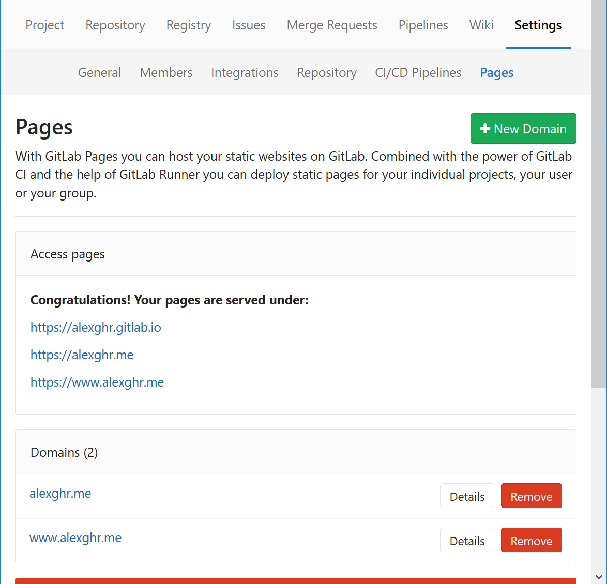

[<< Back to list](/blog)

# {{pageTitle}}
In my last posting I showed the technical bits about how this website is built. This post is dedicated to its hosting solution. 😁

## GitLab
The repository for this website is hosted on the Online version of GitLab so it was only natural to use GitLab Pages to host the actual blog.

You might already be familiar with Github Pages. Well, GitLab's implementation has identical goals: free hosting for static websites. The way they get there, though, is different. While Github only supports raw HTML files or Jekyll websites, GitLab Pages makes use of GitLab CI to work with any kind of build chain. And the best Part? GitLab CI is offered for free to all repositories hosted on the Online version of GitLab.

All you need to do to get GitLab to host your website for you is to define a CI job named `pages` that exports a `public/` directory. The content under `public/` will then be available at `https://<username>.gitlab.io/<repository>` or a custom domain, if you own one. You can get a site up at the root of the domain just by naming the repository `<username>.gitlab.io`.

In this post I am going to go through the GitLab CI and Pages config for this website.

## CI setup
The GitLab docs offer a lot of information on both CI and Pages but it's a little dense for a quick start. I propose a simplified `.gitlab-ci.yml` as a starter config:
```shell
$ cat - > .gitlab-ci.yml <<EOF
pages:
  stage: deploy
  script:
  - echo "building"
  - mkdir public
  - echo "Hello" > public/index.html
  artifacts:
    paths:
    - public
  only:
  - master
EOF
```
There are a couple of things happening in that file so let's take them one by one:
1. It declares a `pages` job. GitLab CI will automatically look for it and run it.
2. `stage: deploy` adds the job to the `deploy` stage. A CI pipeline is formed out of multiple stages. GitLab defines a bunch of default stages (`deploy` being one of them) and you can define custom ones as well. You can read more about them [here](https://docs.gitlab.com/ce/ci/yaml/#stages).
3. The `script` attribute defines the series of steps needed to build the site.
4. It marks the `public/` directory as an artifact. GitLab is going to store it indefinetly on its servers.
5. `only: master` sets up the `pages` job to run only on changes to the `master` branch.

For this site I'm using:
```yaml
image: node:latest

pages:
  stage: deploy
  script:
  - npm install
  - npm run build
  artifacts:
    paths:
    - public
  only:
  - master
```
Not all that different from the starter `.gitlab-ci.yml`. The only new thing is the `image: node:latest` line. Through that I tell GitLab CI that the build script requires the `node:latest` Docker image in order to run. You can use any image available on Docker Hub.

## Custom domain
The only thing left to do is to setup a custom domain to the website. This is a two-step process: first we need to tell GitLab the custom domain we're going to be using and then to update the DNS settings of the domain.

You can add a custom domain to GitLab by going to the Pages settings tab of your repository and clicking on "New domain".


When I first wanted to add the custom domain to GitLab I encountered an error in the settings page telling me to "Contact System Administrator to add domains and certificates". Fortunately, in my case, the issue fixed itself the next day (probably a caching issue?) but if you encouter the same problem you should follow this [thread](https://forum.gitlab.com/t/contact-system-administrator-to-add-domains-and-certificates/6566) on the GitLab Community Forums.

Now on to updating the DNS settings. This step depends on your own solution to managing DNS settings. I'm using Cloudflare because their service is free and comes bundled with a SSL certificate. Be warned though that the way Cloudflare works is by basically man-in-the-middle-ing your website. This is fine for a static website (I'm not worried about Cloudflare serving fake information about me) but could be a problem for a webapp that deals with any kind of user data

Add a new DNS A record to `52.167.214.135` if you plan on serving the site on the naked domain (e.g. just https://alexghr.me) or a CNAME record to `<username>.gitlab.io` if you plan on serving under a subdomain.

## Conclusion
That's it. In two relatively easy steps you can get a website built and deployed to the whole Internet.
