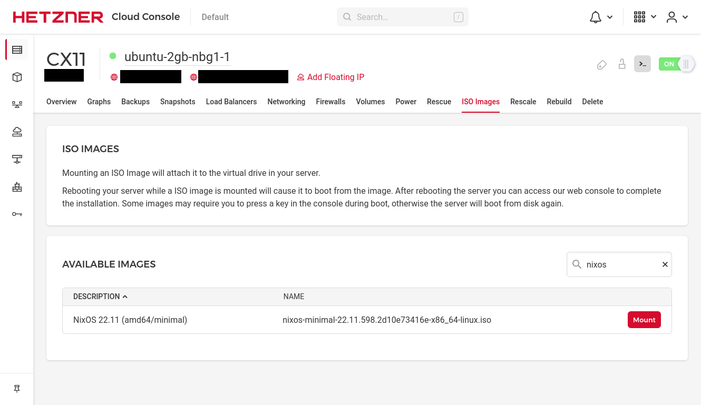
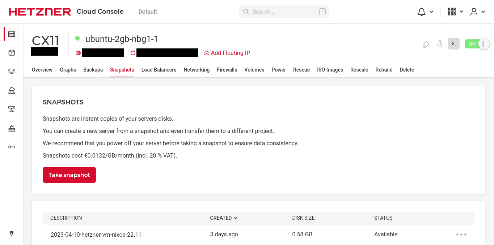
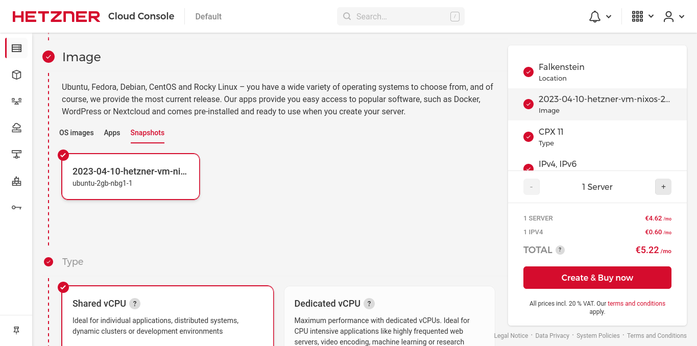

A year ago I migrated the server that hosts this website to run on NixOS. I manually installed the new operating system on a Hetzner VM as a test. Well, temporary things aren’t temporary forever and a year later it’s still up and running. It doesn't have any problems but I didn't take any notes during the installation process and so I’ve forgotten most of the things I did to get the OS installed. This post will serve as a guide for me, a walkthrough, of the steps I followed to get a NixOS VM up and running. Who knows, it might help someone too 🤷

## The goal

I want to build one Golden Snapshot™️ of a NixOS server that I can use to instantiate as many VMs as needed. I want the snapshot to:

1. Be usable to instantiate any of Hetzner's current servers
2. Use Btrfs as the root filesystem
3. Use Nix flakes for the configuration

Regarding the first point, a snapshot can only instantiate VMs that are at least as big as it. If I have a snapshot of server with a 40GB disk, I can’t use it to create a server with a 20GB disk. CX11 is the smallest server currently on offer so that’s what I’ll be using.

Since moving to (almost) full time running Linux I have been using Btrfs as my filesystem of choice. It's a modern filesystem that has some pretty cool features. I've used its ability to send subvolumes when I changed the disk on my computer, basically `btrfs send /home | btrfs recevive /mnt/home` and it moved my entire home folder to the new disk as a whole. I didn't miss any files. And I use Copy-on-Write everyday with [pnpm](https://pnpm.io/). I know some people have had problems in the past, but it never let me down and my computer used to randomly restart due to a [Ryzen bug](https://linustechtips.com/topic/1298348-ryzen-reboot-at-idle-solved-rma/).

Nix Flakes, while still technically an experimental feature, have worked really well for me since I started using them. I've got the configuration for all my machines on my Github at [alexghr/nix](https://github.com/alexghr/nix) and I set up a Github Action to automatically update its inputs every Monday morning.

## Creating the Golden snapshot

To get started with setting up a NixOS VM on Hetzner, add a new CX11 server. The OS doesn't matter since we'll be wiping the disk. Once the server is added, head over to the ISO Images section in the Hetzner Cloud Console and mount the NixOS image.

<figure style="width:66%;display:block;margin:2em auto;">



  <figcaption style="text-align:center">Mounting the latest NixOS ISO</figcation>
</figure>

Now restart the server and open the Web console. The server will automatically boot into the NixOS live environment (aka a `bash` shell 😆).

Next up is preparing the disk for install. My preference is to create two partitions: a small one (a couple of megabytes) for Grub to use for boot at the beginning of the disk and a main parition taking up the rest of the space for everything else.

Yes we need a Grub partition, no Hetzner Cloud servers do not support UEFI (at least I couldn't get it to work).

```bash
sudo parted -s /dev/sda mklabel gpt # wipe the existing partion table
sudo parted -s /dev/sda mkpart primary btrfs 10MB 100% # /dev/sda1 is going to be the main parition
sudo parted -s /dev/sda name 1 linux
sudo parted -s /dev/sda mkpart primary 1 10MB # /dev/sda2 is going to be for Grub
sudo parted -s /dev/sda name 2 grub
sudo parted -s /dev/sda set 2 bios_grub on
```

Now I can create a Btrfs filesystem on `/dev/sda1`. I like to use a couple of subvolumes to separate things:

- `boot` for well... `/boot`
- a `home` subvolume for `/home`. I do this on my workstation, but I might not need it on a server since I won't be creating users 🤔
- a `nix` subvolume for `/nix`
- `nixos` for `/etc/nixos`. I'm currently experimenting with keeping the NixOS configuration on a separate subvolume. I'm not sure how useful this is yet 🤷‍♂️
- a `root` subvolume for the root (`/`) filesystem. I'll need to create mountpoints for all the other subvolumes in this one.

```bash
sudo mkfs.btrfs -L linux /dev/sda1
sudo mount /dev/sda1 /mnt

sudo btrfs subvolume create /mnt/root
sudo btrfs subvolume create /mnt/boot
sudo btrfs subvolume create /mnt/home
sudo btrfs subvolume create /mnt/nix
sudo btrfs subvolume create /mnt/nixos

sudo umount /mnt
sudo mount -o subvol=root /mnt
sudo mkdir -p /mnt/{boot,home,nix,etc/nixos}

sudo mount -o subvol=boot /mnt/boot
sudo mount -o subvol=home /mnt/home
sudo mount -o subvol=nix /mnt/nix
sudo mount -o subvol=nixos /mnt/etc/nixos
```

I've got my Nix configuration up on Github [alexghr/nix/hosts/hetzner-vm/configuration.nix](https://github.com/alexghr/nix/blob/4f6122b22cc25205d3091b9da778ac220627738e/hosts/hetzner-vm/configuration.nix).

> **DON'T USE MY CONFIG WITHOUT MODIFICATIONS.**
> If you do then I'll be able to SSH into your servers because [my public key is allowed for `root`](https://github.com/alexghr/nix/blob/4f6122b22cc25205d3091b9da778ac220627738e/hosts/hetzner-vm/configuration.nix#L65-L67)

Things should be pretty standard, but two things that are really important are:

The boot config. Make sure to tell it to install Grub on `/dev/sda` (it'll find automatically the parition we created for it) otherwise the server won't boot:

```nix
boot.loader.grub = {
  enable = true;
  version = 2;
  forceInstall = true;
  device = "/dev/sda";
};
```

Disable "predictable NIC names" in the boot options so you actually get predictable names that you can use in Nix config, otherwise network interfaces might be named differently in new servers built from the snapshot:

```nix
boot.kernelParams = ["net.ifnames=0"];
networking.interfaces.eth0.useDHCP = true;
```

Cool, that's all. Now I can install the system using my config on Github directly:

```bash
sudo nixos-install --flake github:alexghr/nix#hetzner-vm
```

> I've had issues using a local clone in `/etc/nixos`, the installer saying the config was on a different filesystem.
> It's probably because of the subvolume I made for it. I just let it read directly from Github.

Set a `root` password, shutdown the system and unmount the ISO. Give yourself a pat on the back, the hardest part is done. Go to the Snapshots tab and click "Take snapshot". It should be pretty small, mine came out to only half a gig for the whole system. Hosting this snapshot will cost me about €0.08 per year 😬

<figure style="width:66%;display:block;margin:2em auto;">



  <figcaption style="text-align:center">The Golden Snapshot</figcation>
</figure>

## Using the snapshot to instantiate a new VM

This snapshot should now be available in Add Server flow.

<figure style="width:66%;display:block;margin:2em auto;">



  <figcaption style="text-align:center">Creating a server from the snapshot</figcation>
</figure>
Create the server and in a couple of seconds it should be up and running. Because my SSH public key was in the Nix config for this server, I can just SSH in as root.

On the new server there are a couple of things we'll have to do. First, if the new server has a larger disk than the snapshot then we have to extend the Btrfs partition:

```bash
sudo nix run nixpkgs#parted -- -s /dev/sda resizepart 1 100%
sudo btrfs filesystem resize max /
```

It'll complain that the partition is mounted but I haven't had any issues, yet.

The next thing is generate new SSH host keys:

```bash
sudo rm /etc/ssh/ssh_host_*
sudo systemctl restart sshd.service
```

Lastly generate a new password for `root` 😄

## Conclusion

That's it. Now I've got a snapshot ready to mint new NixOS servers. There are some manual steps needed after the server is created but it should be easy to write a script for this.

PS: I found out `nixos-install` has a `--no-root-password` flag. I need to experiment with this flag, maybe I can drop giving the `root` account a new password

PPS: [Hetzner announced ARM servers](https://www.hetzner.com/news/arm64-cloud/). I guess this guide only works for x86_64 servers right now. I'll see what changes are needed (if any) to build a snapshot ready for ARM64 (maybe just the boot process will be different?).
